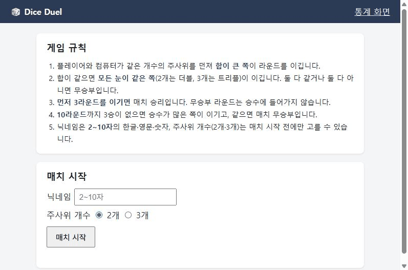

# Dice Duel QA — 샘플 제품으로 재현한 QA 프로세스

[](https://github.com/Juanito-kim/dice-duel-qa/actions/workflows/qa.yml)
· [Cucumber 리포트](https://juanito-kim.github.io/dice-duel-qa/) · 작성: 김성환 (QA Engineer, GitHub: Juanito-kim)

주사위 대결 미니게임 **Dice Duel v1.0**을 직접 만들고, 요구사항 검토부터 자동화·log 모니터링·성능 측정까지 **실제 QA 과정을 처음부터 끝까지** 수행한 기록입니다.
제품은 테스트를 보여주기 위한 최소한으로 만들었고, 이 저장소의 중심은 **테스트 산출물**입니다. 실행하지 않아도 아래 문서만으로 무엇을 어떻게 테스트했는지 볼 수 있습니다.

## QA 과정 한눈에 보기

1. **결과 요약** — [기능 검증 결과](docs/05-test-results.md): 45건 중 PASS 37 · FAIL 6 · BLOCKED 2
2. **요구사항 검토** — [요구사항 명세](docs/01-requirements.md): 규칙 ID(R-01…), 검토하며 정한 것 Q-1~Q-8, 미결 이슈
3. **테스트 설계** — [대표 테스트 케이스 6건](docs/02-test-cases.md#대표-tc-기능별-1건) (경계값·결정 테이블·상태 전이·동시성·데이터 비교·시나리오) · [유저 시나리오](docs/02-user-scenarios.md)
4. **결함 리포트** — [BUG-001](docs/05-defects/BUG-001.md) 판정 오류 (실제 데이터 14건으로 영향 입증) · [BUG-003](docs/05-defects/BUG-003.md) 승률 오류로 순위 뒤바뀜
5. **명세 이슈** — [SPEC-001](docs/05-defects/SPEC-001.md): 기대 결과를 정할 수 없는 지점을 찾아 근거·개선안·QA 권고로 리포트 (PO 결정 대기)
6. **회귀·자동화** — [회귀 시나리오](docs/06-regression.md) → [Gherkin feature](automation/src/test/resources/features/) → [GitHub Actions](https://github.com/Juanito-kim/dice-duel-qa/actions/workflows/qa.yml) → [Cucumber 리포트](https://juanito-kim.github.io/dice-duel-qa/)
7. **서버 log 모니터링** — [수집·ERROR 필터링·경보](monitoring/README.md): 일부러 넣은 오류 수 = 검출 수
8. **성능** — [인스턴스 1·2·3개 측정](perf/report.md): 처리량 ×2.84, 부하 중 동시 중복 요청 300쌍 모두 1건만 처리

## 한눈에 보는 결과

| 영역 | 결과 |
|---|---|
| 기능 검증 (TC 45건) | PASS 37 · **FAIL 6** · **BLOCKED 2** |
| 결함 | **BUG 4건** (Major 3 · Minor 1). 이 중 1건(BUG-004)은 테스트 설계 중 실제로 발견 |
| 명세 이슈 | **SPEC 2건**. 유저 시나리오에서 "중간에 떠나면?", "기간을 거꾸로 넣으면?"을 찾아냄 |
| UI 자동화 (Cucumber 19 시나리오) | PASS 15 · FAIL 4 = **알려진 결함 4건과 정확히 일치**, 새 실패 0 → CI 통과 |
| log 모니터링 | 주입한 오류 17건 (400 8 · 409 9) = 검출 17건 (ERROR 12 · WARNING 5) |
| 성능 | 인스턴스 1 → 3개: 188 → 534 요청/초, 평균 응답 106 → 37ms, 오류 0 |

> 결함 BUG-001~003은 결함 리포트를 보여주기 위해 미리 심은 것이며 [planted-bugs.md](docs/planted-bugs.md)에 위치와 의도를 공개했습니다. BUG-004, SPEC-001, SPEC-002는 테스트하며 실제로 발견한 것입니다.

모든 실행 기록(Sanity, Cucumber 리포트, Jenkins 콘솔, log 모니터, 성능 결과)은 [docs/reports/](docs/reports/README.md)에 날짜별로 모여 있습니다.

## 화면



게임 화면: 규칙 안내 → 매치 시작 → 던지기(굴림 애니메이션) → 3승하면 종료. (GIF는 테스트 모드로 눈을 지정한 데모)
통계 화면: [매치 기록 · 합계 분포(이론 vs 실제) · 닉네임별 승률 순위](docs/images/stats.png)

## Part 1 단계별 산출물

| 단계 | 산출물 | 캡처 |
|---|---|---|
| TC-002 · 01 요구사항 검토 | [01-requirements.md](docs/01-requirements.md) | [png](docs/images/tc002-01-requirements.png) |
| TC-002 · 02 테스트 케이스·유저 시나리오 | [02-test-cases.md](docs/02-test-cases.md) · [02-user-scenarios.md](docs/02-user-scenarios.md) | [TC](docs/images/tc002-02-test-cases.png) · [시나리오](docs/images/tc002-02-scenarios.png) |
| TC-002 · 03 환경 구성·설치 | [03-install.md](docs/03-install.md) | [png](docs/images/tc002-03-install.png) |
| TC-002 · 04 Sanity | [04-sanity.md](docs/04-sanity.md) · [sanity.sh](scripts/sanity.sh) | [png](docs/images/tc002-04-sanity.png) |
| TC-002 · 05 기능 검증·결함 리포트 | [05-test-results.md](docs/05-test-results.md) · [05-defects/](docs/05-defects/) | [결과](docs/images/tc002-05-results.png) · [BUG-001](docs/images/tc002-05-bug-001.png) · [재현 GIF](docs/images/tc002-05-bug-001.gif) · [SPEC-001](docs/images/tc002-05-spec-001.png) |
| TC-002 · 06 회귀 시나리오 | [06-regression.md](docs/06-regression.md) | [png](docs/images/tc002-06-regression.png) |
| TC-003 · Web UI 자동화 | [features](automation/src/test/resources/features/) · [Step·Page Object](automation/src/test/java/qa/diceduel/) · [qa.yml](.github/workflows/qa.yml) · [Jenkinsfile](jenkins/Jenkinsfile) | [feature](docs/images/tc003-01-feature.png) · [실행 GIF](docs/images/tc003-02-selenium-run.gif) · [Actions](docs/images/tc003-03-actions.png) · [Jenkins](docs/images/tc003-03-jenkins.png) · [리포트](docs/images/tc003-03-report.png) |
| TC-003 · Server log 모니터링 | [monitoring/](monitoring/README.md) | [수집](docs/images/tc003-05-log.png) · [ERROR 필터](docs/images/tc003-06-error-filter.png) |
| TC-004 · 성능 | [perf/report.md](perf/report.md) | [Chart](docs/images/tc004-chart.png) · [결과 표](docs/images/tc004-result-table.png) |

## 실행 방법

Docker Desktop만 있으면 됩니다.

```bash
docker compose up -d --build
```

게임 http://localhost:8080 · 통계 http://localhost:8080/stats · API 문서 http://localhost:8080/docs

| 하고 싶은 것 | 명령 |
|---|---|
| Sanity | `bash scripts/sanity.sh` |
| UI 자동화 (JDK 17+, Maven, Chrome) | `cd automation && mvn test` · 최소 세트 `mvn test -Dcucumber.filter.tags=@smoke` |
| log 모니터링 | `docker compose run --rm monitor --once` |
| 성능 측정 | `bash perf/run_perf.sh` |
| Jenkins (http://localhost:8081) | `docker compose -f jenkins/docker-compose.yml up -d --build` |

## 구조

```
브라우저 / Selenium ─┐
                      ├─▶ nginx ─▶ app × N (FastAPI: API + 판정) ─▶ PostgreSQL
Generator (봇 매치) ──┘                    │
                                            └─▶ log 파일 ─▶ monitor (수집 · ERROR 필터 · 경보)
```

| 폴더 | 내용 |
|---|---|
| `app/` | 제품: API·판정 로직(Python FastAPI), 게임·통계 화면, DB 스키마, 봇 매치 Generator |
| `docs/` | 명세, 테스트 케이스, 유저 시나리오, 설치, Sanity, 결과, 결함·명세 이슈, 회귀, 캡처 |
| `docs/reports/` | **테스트 실행 리포트 모음**: Sanity, 기능 검증, Cucumber 리포트(Actions·Jenkins), log 모니터링, 성능 결과의 원본 |
| `automation/` | Cucumber(Gherkin) + Selenium WebDriver (Java, Maven), Page Object |
| `.github/workflows/` · `jenkins/` | CI: GitHub Actions (공개 결과) · Jenkins (Docker) |
| `monitoring/` | log 수집·ERROR 필터링 스크립트 |
| `perf/` | 성능 측정 스크립트, 결과, 리포트 |
| `scripts/` | Sanity, 기능 검증 보조, 자동화 결과 판정(알려진 결함 외 실패 검출) |
