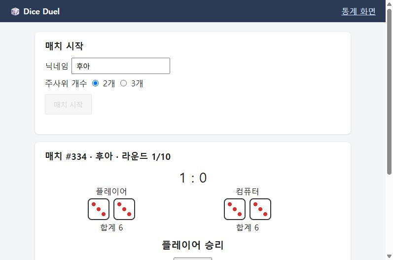

# BUG-001 합과 더블이 모두 같으면 무승부여야 하는데 플레이어 승리로 판정됨

| 항목 | 내용 |
|---|---|
| 유형 / 심각도 / 우선순위 | Bug / **Major** / P1 |
| 상태 | Open (v1.0 릴리스 전 수정 필요) |
| 관련 규칙 | [R-02](../01-requirements.md) 합이 같으면 모든 눈이 같은 쪽이 승리. **둘 다 같으면 무승부** |
| 관련 TC | ★ [TC-B05](../02-test-cases.md) (결정 테이블 8칸 중 이 칸만 FAIL) |
| 발견 | 2026-10-27, 김성환, 기능 검증 |
| 환경 | Dice Duel v1.0 (`main`), Docker Compose, Chrome — [03-install.md](../03-install.md) |
| 발생 빈도 | 주사위 2개 매치에서 양쪽이 같은 더블이 나올 때마다 **항상**. 실제 데이터 3,358라운드 중 14회 (0.42%, 이론 1/216 = 0.46%) |

## 재현 절차

**방법 1: 테스트 모드로 바로 재현 (1분)**
1. 게임 화면에서 닉네임 `후아`, 주사위 2개로 매치를 시작한다 (예: 매치 #334)
2. 다음 라운드 눈을 지정한다
   ```bash
   curl -X POST http://localhost:8080/api/test/next-roll -H "Content-Type: application/json" -d "{\"match_id\":334,\"player\":[3,3],\"cpu\":[3,3]}"
   ```
3. 던지기 버튼을 누른다

**방법 2: 테스트 모드 없이 실제 데이터로 확인**
- 클린 설치 직후 초기 데이터(seed 42)의 **매치 #49 3라운드**가 [2,2] vs [2,2]이고 결과가 "플레이어 승리"로 저장되어 있다.
  ```sql
  SELECT match_id, round_no, player_dice, cpu_dice, result FROM rounds WHERE match_id = 49 AND round_no = 3;
  ```

## 기대 결과
- 라운드 결과 **"무승부"**, 스코어 **0 : 0** (R-02: 합 6 = 6, 양쪽 모두 더블 → 무승부)

## 실제 결과
- 라운드 결과 **"플레이어 승리"**, 스코어 **1 : 0**



실제 데이터에서 같은 조건 14회가 **모두** 플레이어 승리로 저장됨 ([evidence/05-bug-001-occurrence.txt](../evidence/05-bug-001-occurrence.txt)):

| 매치 | 라운드 | 플레이어 | 컴퓨터 | 저장된 결과 |
|---|---|---|---|---|
| #49 | 3 | [2,2] | [2,2] | PLAYER |
| #95 | 2 | [3,3] | [3,3] | PLAYER |
| #119 | 2 | [1,1] | [1,1] | PLAYER |

## 영향
- **판정 결과가 틀린다.** 무승부여야 할 라운드가 플레이어 승수로 들어가 매치 승패가 바뀔 수 있다 (예: 2:2에서 이 라운드가 나오면 플레이어가 3승으로 매치 승리).
- 플레이어 쪽으로만 치우치므로 승률 통계도 플레이어에게 유리하게 왜곡된다.
- 발생 확률은 낮지만(약 0.5%), 공정성이 핵심인 게임 규칙이라 심각도를 Major로 판단했다.
- 주사위 3개 매치(같은 트리플끼리)도 같은 규칙이므로 같은 결함이 있을 가능성이 높다. 실제 데이터에는 아직 발생 사례가 없어 지정 눈 [2,2,2] vs [2,2,2]로 수정 확인 때 함께 검증한다.

## 회귀
- [06-regression.md](../06-regression.md)에 등록. 수정 후 결정 테이블 B01~B08 전체를 다시 수행한다 (한 칸을 고치다 다른 칸이 깨지는 것을 막기 위해).
