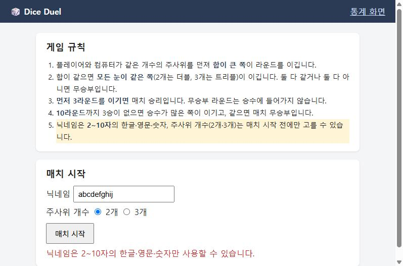

# BUG-002 10자 닉네임이 거부됨 (화면 안내는 "2~10자")

| 항목 | 내용 |
|---|---|
| 유형 / 심각도 / 우선순위 | Bug / **Major** / P2 |
| 상태 | Open |
| 관련 규칙 | [R-06](../01-requirements.md) 닉네임은 2~10자, 한글·영문·숫자 · [U-01](../01-requirements.md) 화면 규칙 안내 |
| 관련 TC | ★ [TC-A03](../02-test-cases.md) (영문 10자), TC-A04 (한글 10자) · 유저 시나리오 [US-02](../02-user-scenarios.md) |
| 발견 | 2026-10-27, 김성환, 경계값 분석 |
| 환경 | Dice Duel v1.0 (`main`), Docker Compose, Chrome |
| 발생 빈도 | 10자 닉네임이면 **항상** (영문·한글 모두) |

## 재현 절차
1. 게임 화면을 연다 (http://localhost:8080)
2. 규칙 안내 5번째 줄 "닉네임은 **2~10자**의 한글·영문·숫자"를 확인한다
3. 닉네임에 `abcdefghij`(영문 10자)를 넣고 "매치 시작"을 누른다

## 기대 결과
- 매치가 시작된다 (R-06: 2~10자 허용, 10자는 허용 범위의 최댓값)

## 실제 결과
- 매치가 시작되지 않고 "닉네임은 2~10자의 한글·영문·숫자만 사용할 수 있습니다." 문구가 나온다
- 한글 10자 `가나다라마바사아자차`도 API에서 400으로 거부된다
- 서버 log: `ERROR … match rejected: invalid nickname='abcdefghij'`

## 경계값 결과 (원인 범위를 좁히기 위해)

| 길이 | 입력 | 기대 | 실제 | 판정 |
|---|---|---|---|---|
| 1자 | `a` | 거부 | 거부 | PASS |
| 2자 | `ab` | 허용 | 허용 | PASS |
| **10자** | `abcdefghij` | **허용** | **거부** | **FAIL** |
| 11자 | `abcdefghijk` | 거부 | 거부 | PASS |

→ 하한(2자)은 맞고 **상한만 1자 짧게(9자) 처리**되는 것으로 보인다. 길이 검사의 최댓값 확인을 요청한다.

## 영향
- **화면 안내를 그대로 따른 사용자가 거부당한다.** 오류 문구도 "2~10자"라고 안내해서, 사용자는 무엇이 잘못됐는지 알 수 없다.
- 회피 방법은 있다(9자 이하 사용). 하지만 안내와 동작이 모순되는 결함이라 Major로 판단했다.

## 회귀
- 수정 후 경계값 1·2·9·10·11자를 영문·한글 모두 다시 수행한다.
