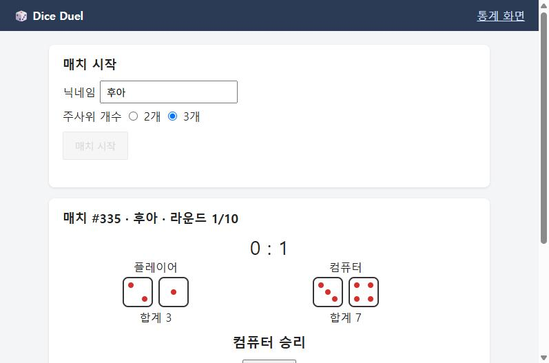

# BUG-004 매치 중에도 주사위 개수 선택이 바뀌어 보임

| 항목 | 내용 |
|---|---|
| 유형 / 심각도 / 우선순위 | Bug / **Minor** / P3 |
| 상태 | Open |
| 관련 규칙 | [R-05](../01-requirements.md) 주사위 개수는 **매치 시작 전에만** 고를 수 있다 |
| 관련 TC | [TC-A10](../02-test-cases.md) · 유저 시나리오 [US-05](../02-user-scenarios.md) |
| 발견 | 2026-10-26 TC 작성 중 발견, 2026-10-27 기능 검증에서 확인. **일부러 심은 결함이 아님** |
| 환경 | Dice Duel v1.0 (`main`), Chrome |
| 발생 빈도 | 매치 진행 중 라디오 버튼을 누르면 **항상** |

## 재현 절차
1. 게임 화면에서 주사위 **2개**를 고르고 매치를 시작한다
2. 매치 진행 중에 "주사위 개수"의 **3개** 라디오 버튼을 누른다
3. 던지기 버튼을 누른다

## 기대 결과
- 매치 진행 중에는 주사위 개수 선택을 바꿀 수 없다 (비활성화). 선택은 2개 그대로

## 실제 결과
- 3개 라디오가 **선택된 상태로 바뀐다**
- 실제 매치는 2개로 계속 진행된다 (서버 판정은 정상)
- 화면에 "3개"가 선택된 채로 주사위 2개가 나와 **화면 정보가 서로 모순**된다

## 영향
- 데이터와 판정에는 영향이 없다 (서버는 매치 시작 때 정한 개수를 사용).
- 사용자는 "3개로 바꿨다"고 오해하거나, 주사위가 2개만 나와 오류로 볼 수 있다.
- 닉네임 입력란도 매치 중에 수정할 수 있어 같은 종류의 문제다 (실제 매치 닉네임은 바뀌지 않음). 함께 수정을 권고한다.
- 기능 영향이 없어 Minor로 판단했다.

## 회귀
- 수정 후 TC-A10과 함께, 매치가 끝난 뒤 "새 매치"를 누르면 다시 선택할 수 있는지도 확인한다.
