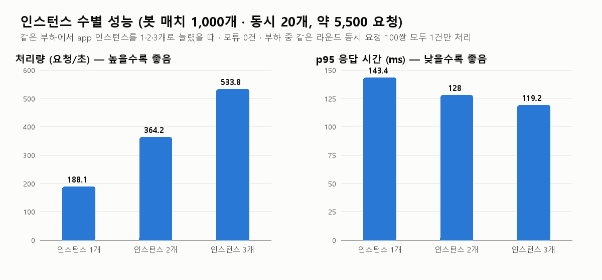

# TC-004 성능 측정 결과 — Dice Duel v1.0

> Part 1 · TC-004 · 01~06 · 수행: 2026-10-27 14:25~14:27 · 수행자: 김성환
> 스크립트: [run_perf.sh](run_perf.sh) · [dup_under_load.py](dup_under_load.py) · [summarize.py](summarize.py) · 요약 데이터: [results.json](results.json)

## 1. 목적

1. 봇 매치를 동시에 많이 진행할 때 **처리량과 응답 시간**이 어느 정도인지 확인한다.
2. app 인스턴스를 **1 → 2 → 3개**로 늘리면 성능이 얼마나 좋아지는지 확인한다 (수평 확장).
3. 부하 중에 **같은 라운드 던지기 요청이 동시에 두 번** 와도, 서로 다른 인스턴스로 갈라져도 **한 번만 처리**되는지 확인한다 (R-09, TC-E02, RG-08).

## 2. 환경과 부하 조건

| 항목 | 값 |
|---|---|
| 장비 | 개발 PC 1대 (Windows 11, CPU 16개, 메모리 16GB, Docker Desktop). app·DB·nginx·부하 발생기가 **모두 같은 PC**에서 실행 |
| 구성 | nginx(로드밸런서) → app × N (FastAPI) → PostgreSQL 16 |
| 인스턴스 수 | 1, 2, 3 (`docker compose up -d --scale app=N`) |
| 부하 | Generator 봇 매치 **1,000개**, 동시 **20개**, 매치마다 끝날 때까지 던지기 (약 5,500 요청) |
| 동시 중복 확인 | 부하 시작 3초 뒤부터, 같은 라운드 던지기 요청 2건을 동시에 보내기 × **100쌍** |
| 측정 | Generator 요약(처리량, 평균·p95·최대 응답 시간, 상태 코드, 인스턴스별 처리 건수), `docker stats` 2초 간격(CPU·메모리), DB 직접 조회(중복 라운드) |

## 3. 결과



| 인스턴스 | 요청 수 | 소요 시간 | **처리량** | 평균 응답 | **p95 응답** | 최대 응답 | 오류 | 인스턴스별 처리 | app CPU 최고(합) | DB CPU 최고 |
|---|---|---|---|---|---|---|---|---|---|---|
| 1 | 5,552 | 29.5초 | **188 요청/초** | 105.9ms | **143.4ms** | 201.7ms | 0 | 5,552 | 169% | 20% |
| 2 | 5,547 | 15.2초 | **364 요청/초** (×1.94) | 54.6ms | **128.0ms** | 158.6ms | 0 | 2,761 / 2,786 | 238% | 37% |
| 3 | 5,463 | 10.2초 | **534 요청/초** (×2.84) | 37.2ms | **119.2ms** | 169.7ms | 0 | 1,816 / 1,817 / 1,830 | 309% | 53% |

CPU 100% = 코어 1개. app 메모리는 인스턴스당 43~57MB로 부하와 상관없이 거의 일정했다.

### 부하 중 같은 라운드 동시 요청 (R-09)

| 인스턴스 | 쌍 | 1건만 처리된 쌍 | 두 요청이 **다른 인스턴스로** 간 쌍 | DB 중복 라운드 |
|---|---|---|---|---|
| 1 | 100 | **100** | 0 | **0** |
| 2 | 100 | **100** | 97 | **0** |
| 3 | 100 | **100** | 99 | **0** |

app log의 시각으로 확인한 결과, 세 경우 모두 중복 요청 확인 구간이 부하 구간 안에 있었다 (예: 인스턴스 3개 — 부하 14:26:23~33, 중복 확인 14:26:26~34).

## 4. 해석

- **처리량은 인스턴스 수에 거의 비례해 늘었다** (1개 대비 2개 ×1.94, 3개 ×2.84). nginx가 요청을 고르게 나눴다 (3개일 때 1,816 / 1,817 / 1,830건).
- **평균 응답 시간은 크게 줄었지만(106 → 37ms), p95는 덜 줄었다(143 → 119ms).** 느린 요청 일부는 인스턴스 수와 상관없는 공통 구간(DB 잠금, 같은 PC에서 함께 도는 부하 발생기)에서 생기는 것으로 보인다.
- **DB CPU가 인스턴스 수와 함께 올라간다 (20% → 53%).** 인스턴스를 더 늘리면 다음 병목은 DB가 될 가능성이 높다. 4개 이상은 DB 지표를 함께 보며 측정해야 한다.
- **동시성은 안전하다.** 두 요청이 서로 다른 인스턴스로 갈라진 경우(최대 99쌍)에도 매번 1건만 처리되고 DB에 중복 라운드가 없었다. 인스턴스 메모리 상태가 아니라 DB 행 잠금(`SELECT … FOR UPDATE`)과 라운드 번호 검사로 막기 때문이다.

## 5. 결론

| 목적 | 결과 |
|---|---|
| 동시 20매치 부하 처리 | 인스턴스 1개로 188 요청/초, p95 143ms, 오류 0건 |
| 수평 확장 효과 | 3개에서 처리량 ×2.84, 평균 응답 −65%. 확장이 유효하다 |
| 동시 중복 요청 (R-09) | 300쌍 모두 1건만 처리, 중복 0건 → **PASS** |

## 6. 한계와 다음 측정

- **모든 구성 요소와 부하 발생기가 한 PC에 있다.** 절대 수치는 실제 서버 환경과 다르다. 이 측정은 **인스턴스 수에 따른 상대적인 변화**를 보는 것이 목적이다.
- 측정 시간이 짧다 (10~30초). 장시간 부하(메모리 누수, 연결 고갈)는 측정하지 않았다.
- 다음에 측정한다면: 인스턴스 4·6개 + DB 지표(잠금 대기, 연결 수), 30분 이상 장시간 부하, 부하 발생기를 다른 장비로 분리.

## 7. 재현

```bash
bash perf/run_perf.sh
```
```bash
docker run --rm -v "%cd%:/repo" -v "C:\Windows\Fonts:/fonts:ro" -w /repo python:3.12-slim sh -c "pip install -q pillow && python perf/summarize.py"
```

원본 결과(`perf/raw/`)는 실행할 때마다 새로 만들어져 저장소에 넣지 않는다. 요약은 [results.json](results.json)에 있다.
